# Adaptive Multimodal RAG Architecture

```mermaid
flowchart TB
    user["User"]
    ui["Streamlit UI\napp/ui/streamlit_app.py"]
    api["FastAPI App\napp/api/main.py"]
    startup["Startup Validation\napp/api/startup.py"]
    config["Settings\napp/core/config.py"]
    deps["Dependencies\napp/core/dependencies.py"]

    ingest_route["Ingest Route\n/ingest/pdf"]
    query_route["Query Route\n/query"]
    docs_route["Documents Route\n/documents"]
    health_route["Health Route\n/health"]
    eval_route["Evaluation Routes\n/evaluation/*"]
    metrics_route["Metrics Route\n/metrics"]

    parser["PDF Parser\napp/services/ingestion/parser.py"]
    chunker["Recursive Chunker\napp/services/ingestion/chunker.py"]
    embedder["Embedding Provider\napp/services/ingestion/embedder.py"]
    indexer["Document Indexer\napp/services/ingestion/indexer.py"]

    dense["Dense Retriever"]
    sparse["BM25 Retriever"]
    hybrid["Hybrid Retriever"]
    reranker["Cross Encoder Reranker"]

    router["Intent Router"]
    planner["Query Planner"]
    engine["Multi Step Engine"]
    memory["Session Memory"]
    guardrails["Guardrails\nconfidence, citation, abstain"]

    llm_builder["LLM Provider Builder"]
    groq["Groq Provider"]
    openai["OpenAI Provider"]
    fallback["Grounded Fallback Provider"]

    metadata["Metadata Store\nSQLite"]
    bm25["BM25 Store"]
    qdrant["Qdrant Vector Store"]
    runtime["Runtime Data\nuploads, logs, db"]

    embed_model["Local Embedding Model\n/app/models/bge-small-en-v1.5"]
    rerank_model["Local Reranker Model\n/app/models/bge-reranker-base"]

    eval_logger["Evaluation Logger"]
    eval_service["Evaluation Service"]

    compose["Docker Compose"]
    backend["Backend Container"]
    ui_container["UI Container"]
    qdrant_container["Qdrant Container"]

    user --> ui
    user --> api

    ui --> ingest_route
    ui --> query_route
    ui --> eval_route
    api --> startup
    api --> ingest_route
    api --> query_route
    api --> docs_route
    api --> health_route
    api --> eval_route
    api --> metrics_route

    startup --> config
    startup --> deps
    deps --> config

    ingest_route --> indexer
    indexer --> parser
    indexer --> chunker
    indexer --> embedder
    indexer --> metadata
    indexer --> bm25
    indexer --> qdrant

    embedder --> embed_model

    query_route --> router
    query_route --> planner
    query_route --> engine
    query_route --> memory
    query_route --> guardrails
    query_route --> llm_builder

    engine --> hybrid
    engine --> dense
    engine --> reranker

    hybrid --> dense
    hybrid --> sparse

    dense --> qdrant
    dense --> metadata
    sparse --> bm25
    sparse --> metadata
    reranker --> rerank_model

    llm_builder --> groq
    llm_builder --> openai
    llm_builder --> fallback

    eval_route --> eval_service
    metrics_route --> eval_service
    query_route --> eval_logger
    eval_logger --> metadata
    eval_service --> metadata

    metadata --> runtime
    bm25 --> runtime
    qdrant --> runtime

    compose --> backend
    compose --> ui_container
    compose --> qdrant_container
    backend --> api
    ui_container --> ui
    qdrant_container --> qdrant
```

## Flow Summary

- User uploads PDF through Streamlit or API.
- Backend validates startup config and local model paths.
- Ingestion parses the PDF, chunks text, creates embeddings, and stores data in Qdrant plus SQLite and BM25.
- Query flow retrieves chunks, optionally reranks them, applies guardrails, and generates a grounded answer.
- Evaluation services read logged traces and indexed metadata.
- Docker Compose runs backend, UI, and Qdrant together with local offline models.
